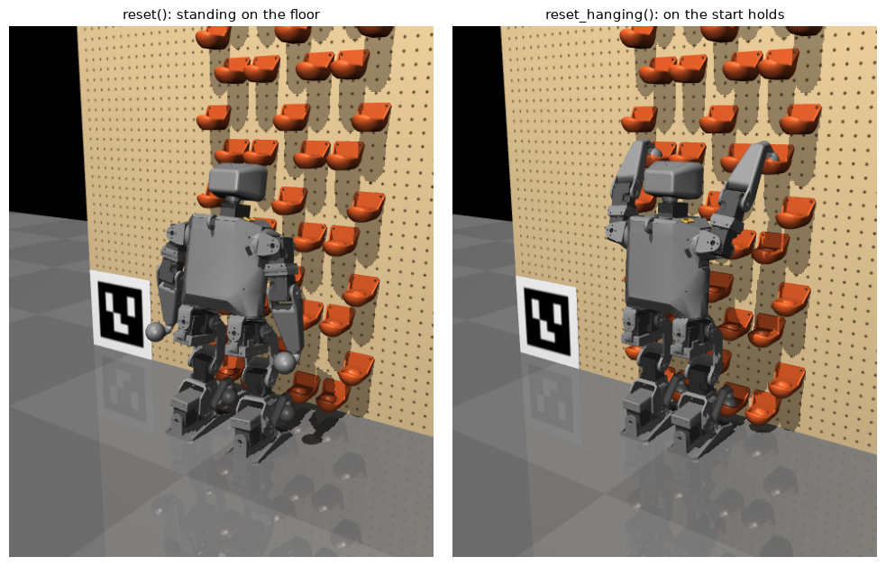
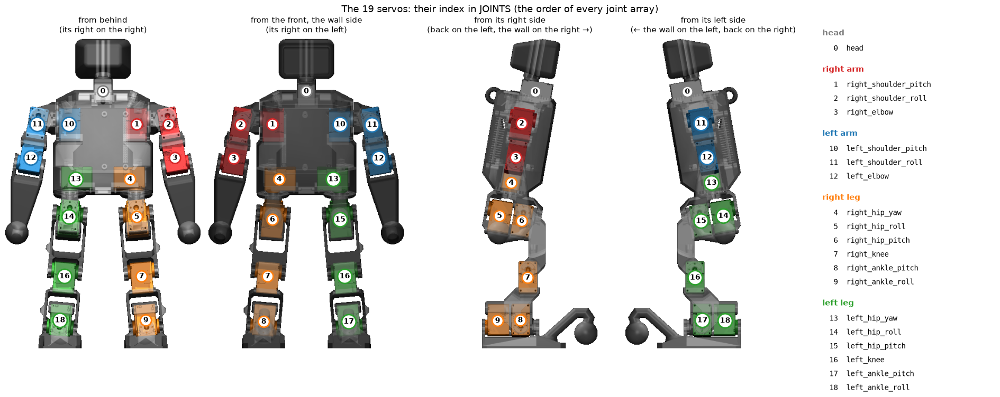
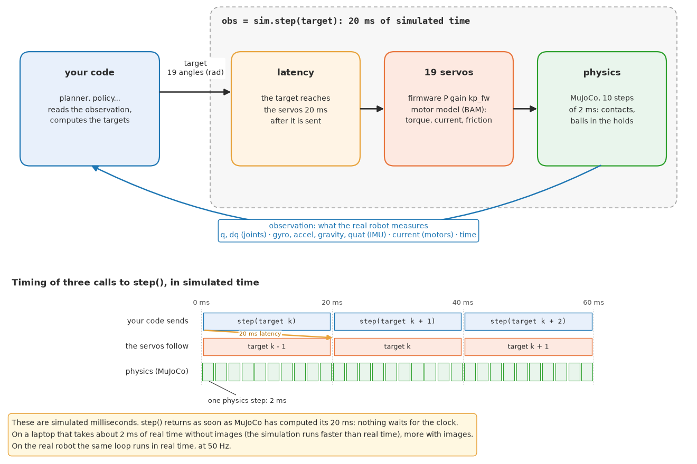
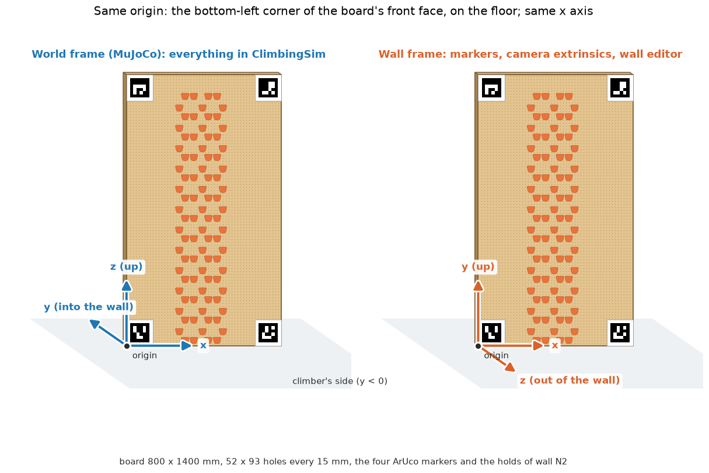
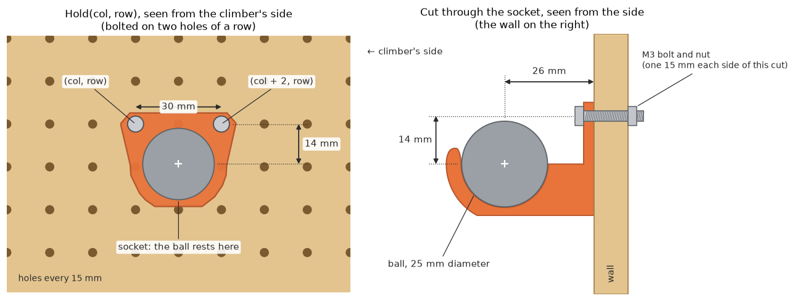

# Climbing robot simulator

MuJoCo simulator of the hackathon's climbing robot (Microban with climbing arms and legs) on the competition
wall: the robot and its 19 servos, the 800 x 1400 mm board with its hole grid, the holds, the four ArUco corner
markers and the two cameras. Your job: make the robot climb, by motion planning, reinforcement learning or both.



**Two ways to simulate**, the same robot and the same physics underneath:

| | Fast: plan, learn, evaluate | As on the robot: test before deploying |
|---|---|---|
| What | this package, in Python: `sim.step(target)` | the robot's own program on this wall: `make sim WALL=N2` in microban |
| Speed | as fast as it computes (~2 ms per 20 ms step), no window (`sim.view()` to watch) | real time, 50 Hz, MuJoCo's window |
| Your code | your planner, your RL, your moves (`run_move`) | your moves (`src/moves/`), exactly what `make deploy` sends |
| Around it | save / restore a state, many processes in parallel | keys in the viewer, live dashboard, torque off at start, the robot's safeties |

The sensors are the robot's in both (with their delays): what works in one works in the other.

**Contents:** [Install](#install) · [Quick start](#quick-start) · [The robot](#the-robot) ·
[Controlling the robot](#controlling-the-robot) · [Frames](#frames) · [Walls and holds](#walls-and-holds) ·
[Cameras](#cameras) · [Examples](#examples) · [What is simulated](#what-is-simulated) · [Layout](#layout)

## Install

Clone it next to the robot's code ([Rhoban/microban](https://github.com/Rhoban/microban), branch `dev_v2`): the
simulator is yours to read and change, and the robot's program uses it from there.

**What you need on your PC** (Linux; macOS: below; Windows: in [WSL](https://learn.microsoft.com/windows/wsl/install),
Ubuntu, then all as on Linux): git with **git-lfs** (the robot model's meshes), `make`, and
[uv](https://docs.astral.sh/uv/getting-started/installation/):

```bash
sudo apt install git git-lfs make && git lfs install      # macOS: brew install git-lfs && git lfs install
curl -LsSf https://astral.sh/uv/install.sh | sh
```

```bash
mkdir hackathon && cd hackathon
git clone https://github.com/rock-climbing-robots/simulator
git clone -b dev_v2 https://github.com/Rhoban/microban
```

Then, in `simulator/`, with [uv](https://docs.astral.sh/uv/getting-started/installation/) (Python 3.12 or newer,
installed by uv if needed):

```bash
uv sync                          # .venv with Rhoban's robot simulator (microban_sim: the robot, its servos simulated
                                 # by BAM), mujoco, numpy, pillow; version bounds in pyproject.toml
uv run python examples/view.py   # the robot hanging on the start holds of wall N2, in MuJoCo's viewer
```

`uv run <command>` runs anything in the project's environment (or `source .venv/bin/activate` once). Installed before
2026-10-29? `uv sync --upgrade` brings microban_sim up to date (`run_move`, `load_moves`). On macOS, MuJoCo's viewer
needs `mjpython` instead of `python` (`uv run mjpython examples/view.py`); everything without a window runs as is.

**The robot's program on the simulated wall.** From `microban/`: `make sim WALL=N2` runs the robot's own program
(your moves of `src/moves/`, their keys in the viewer, the live dashboard) on this simulator, the robot hanging on
the wall ([your moves](#your-moves-the-same-file-on-the-robot)). It uses
this folder as it is: what you change here applies at once (microban's `docs/simulation.md`).

## Quick start

```python
from climbing_sim import ClimbingSim, JOINTS

sim = ClimbingSim(wall="N2")         # a competition wall, two default cameras
obs = sim.reset_hanging()            # the robot hanging on the wall's four start holds
for t in range(500):                 # 500 x 20 ms = 10 s
    target = obs["q"]                # your move: 19 joint angles (rad), in the order of JOINTS
    obs = sim.step(target)           # one 20 ms control step
print(sim.hooked())                  # which hold each ball is in
image = sim.render("cam_left")       # (H, W, 3) uint8
```

## The robot



The robot has **19 joints**, each driven by a Dynamixel XL330 servo. The figure shows each servo, numbered with
its index in `climbing_sim.JOINTS`, from the four sides (the rest of the robot is see-through, so the servos
inside the trunk show). Everything that takes or returns joint angles uses this order: `JOINTS.index("right_knee")`
is 7. Angles are in radians; `sim.joint_range` gives each joint's limits (19 x 2, min and max).

It has **four limbs**, `LIMBS = ["left_hand", "right_hand", "left_foot", "right_foot"]`, each ending in a
25 mm ball (12.5 mm radius) that hooks into a hold's socket.

## Controlling the robot

### Starting

| | |
|---|---|
| `sim.reset_hanging()` | The robot hanging on the wall's four start holds, the four balls in the sockets (the usual start for climbing). `start={limb: Hold}` picks other holds. |
| `sim.reset()` | The robot standing on the floor in front of the wall, feet 74.5 mm from it (to mount the wall from the floor). `trunk_pos`, `trunk_quat` and `joints={name: angle}` change the pose. |

`reset()` uses the standing pose of Rhoban's walking robot (left image above), the pose the real robot stands in by
itself: arms along the body (**shoulder pitches at pi/2**, shoulder rolls +-10 deg, elbows -20 deg), hips pitched
-10 deg, hip and ankle rolls +-5 deg, **all the other motors at 0**. At `kp_fw=400` it stands still; with soft
servos (`kp_fw=125`) it falls unless balanced actively.

### The control loop



`obs = sim.step(target)` sends the 19 joint targets (rad, order `JOINTS`) and simulates 20 ms
(`sim.control_dt`); `target=None` keeps the last ones. As on the real robot, the servos act on a target 10 ms
after it is sent (measured on the robot: its program reads the sensors, computes, then writes), and a joint under
load stops short of its target.

These 20 ms are **simulated time**: `step()` returns as soon as MuJoCo has computed them, about 2 ms of real time
on a laptop without images. The simulation does not run in real time; the real robot runs the same loop at
50 Hz.

### The observation: what the real robot measures

`step()` returns it, `sim.observation()` gives it at any time. A move meant for the real robot may use only
this. The IMU values are in the trunk frame (see [Frames](#frames)). As on the robot, some arrive late: the joint
velocities by one step (20 ms), the gyro and the accelerometer by 3, the orientation (`gravity`, `quat`) by 4
(`ClimbingSim(ideal_sensors=True)`: none, for debugging).

| Key | Shape | Unit | What |
|---|---|---|---|
| `q` | 19 | rad | joint angles (servo encoders), order `JOINTS` |
| `dq` | 19 | rad/s | joint velocities |
| `gyro` | 3 | rad/s | IMU angular velocity, trunk frame |
| `accel` | 3 | m/s² | IMU acceleration, trunk frame (includes gravity: about +9.81 upwards at rest) |
| `gravity` | 3 | - | unit vector of gravity (pointing down), trunk frame |
| `quat` | 4 | - | trunk orientation (w, x, y, z), world frame |
| `current` | 19 | A | motor currents |
| `time` | 1 | s | simulated time |

### Ground truth: not measured on the real robot

For debugging, rewards and evaluation, in the world frame:

* `sim.ball_positions()`: limb -> xyz of its ball's centre;
* `sim.trunk_pose()`: the trunk's position and quaternion (w, x, y, z);
* `sim.hooked()`: limb -> index in `sim.wall.holds` of the hold its ball is in, or None;
* `sim.wall.sockets()`: the position of every hold's socket.

### Tools for planning

In the world frame; none of these moves the simulation:

* `sim.ball_positions_at(q, trunk_pos, trunk_quat)`: **forward kinematics**, where the four balls would be for
  joint angles `q` and a trunk pose (default: the current one).
* `sim.joint_angles_for(balls, trunk_pos, trunk_quat)`: **inverse kinematics**, joint angles that put the balls
  (`{limb: xyz}`, some or all limbs) at those points, the trunk at that pose. Returns `(q, error)`, `error` being
  the largest distance left (m): check it, a point out of reach stays off.
* `state = sim.get_state()`, then some `step()`s, then `sim.set_state(state)`: **try a motion and come back**.
  The same steps from the same state give exactly the same motion.

### Your moves: the same file on the robot

Everything the robot does is a **move**: a class with `step(obs) -> targets` (19 angles, or `{joint: angle}`; `None`
ends it), and optionally `start(obs)`, `stopping(obs)`, `kp`, `options` and `sliders`; no base class needed.
`examples/move.py` has the shape, microban's [docs/moves.md](https://github.com/Rhoban/microban/blob/dev_v2/docs/moves.md)
the whole guide.

* **On the robot**: put the file in `microban/src/moves/` (microban, branch `dev_v2`). The robot's program finds it by
  itself: it appears in the dashboard, with Start / Stop and its options and sliders (edited live).
  `make sim WALL=N2` runs it in the robot's program on this simulator, `make deploy` sends it to the robot.
* **Here, in Python** (options and sliders at their defaults):

  ```python
  from climbing_sim import ClimbingSim, load_moves, run_move
  sim = ClimbingSim("N2"); sim.reset_hanging()               # (run from simulator/: the paths below are from there)
  moves = load_moves("../microban/src/moves/my_move.py")   # {name: move}: MyMove -> "my"
  run_move(moves["my"], sim, 30)                            # 30 s of simulated time, its kp while it runs
  ```

Use only the observation in it, and JOINTS from `microban_model` (the same order as `climbing_sim.JOINTS`), which
the robot has too.

### Reinforcement learning

> **Keep `kp_fw=125`** (`ClimbingSim(kp_fw=125)`), the gain the real robot runs its learned policies at. The
> default 400 (the XL330's factory gain) is for motion planning and kinematics.

`examples/rl_env.py` is a minimal Gymnasium environment to start from (observation = what the robot measures; the
reward and the end of an episode are yours to write). One `ClimbingSim` is one robot on the CPU: run several
processes for many robots at once.

### Options and attributes

`ClimbingSim(wall="N2", cameras=None, control_dt=0.02, latency_ms=10.0, kp_fw=400.0, vin=7.5, ideal_sensors=False, seed=None)`

* `wall`: a bundled wall name (`"N1"`, `"N2"`, `"N3"`), a wall JSON file or a `Wall`.
* `cameras`: a camera JSON file (see [Cameras](#cameras)), a list of `Camera`, `None` for two default cameras, or
  `[]` for none (faster when you do not render).
* `control_dt`: the duration of one `step()` (s); `latency_ms`: the command latency.
* `kp_fw`: the servos' firmware P gain, 400 (factory) by default, 125 for reinforcement learning.
* `vin`: the servos' supply voltage (V); `seed`: seed of `sim.rng`, a numpy generator for your own randomisation.
* `ideal_sensors`: every measurement of the current step, without the robot's delays.

`sim.view()` opens MuJoCo's viewer on the simulation: the steps then show in it, at real time
(`sim.view(realtime=False)`: as fast as they compute).

`sim.set_torque(False)` makes the servos limp, as the real robot's Torque Enable (one bool, or 19 in the order
`JOINTS`); `reset()` and `reset_hanging()` put the torque back on.

`sim.render(camera)` gives an RGB image from `"cam_left"`, `"cam_right"` (or your cameras' names) or
`"overview"`. `sim.model` / `sim.data` are the plain MuJoCo objects; `climbing_sim.build_spec()` gives the scene
as an `MjSpec` to modify.

## Frames



* **World frame** (MuJoCo, everything in `ClimbingSim`): origin at the bottom-left corner of the board's front
  face seen from the climbing side, on the floor; x to the right, y into the wall, z up. The robot is on the
  y < 0 side; the floor is z = 0.
* **Wall frame** (markers, camera extrinsics, the wall editor): same origin, x right, y up, z out of the wall.
  `wall_to_world()` / `world_to_wall()` convert points.
* **Trunk frame** (the IMU values of the observation): x forward (the robot's front, towards the wall when it
  climbs), y to the robot's left, z up along its spine. When the robot stands upright, `gravity` is about
  (0, 0, -1).

## Walls and holds



The board has a grid of 52 x 93 holes, 15 mm apart: columns 0-51 from the left, rows 0-92 from the bottom. A hold
is fixed by two M3 bolts through two holes of one row: `Hold(col, row)` names its **left** hole, the right one is
`(col + 2, row)`. The ball rests in the socket, 26 mm out of the wall and 14 mm below the bolts, centred between
them (`hold.socket` gives its world position).

A wall is a list of holds in climbing order plus the four start holds (`Wall`, saved as JSON). Following the
rulebook, **reaching the top** means touching one of the wall's highest holds.

**The competition walls** `N1`, `N2`, `N3` (the rulebook's difficulty levels 1-3) are bundled:
`ClimbingSim(wall="N2")`.

**More routes** from `climbing_sim.routes.generate_wall(level, seed)` (seed 0 of levels 1-3 gives the
competition walls). Every route is a stack of rungs of four holds (feet 75 mm apart, hands 165 mm apart) with
intermediate holds between them, the robot's start stance at the bottom:

| Level | Route |
|---|---|
| N1 | the regular ladder, rungs every 75 mm (the same for every seed) |
| N2 | a ladder with missing holds: rungs every 105 mm, about 30 % of the holds removed at random |
| N3 | the robot has to move right and left: the N2 ladder following a random walk (at most 30 mm per rung, 150 mm from the middle), about 25 % of the holds removed |
| N4 | extra challenge (not in the rulebook for now): the route forks at 600 mm into two branches drifting apart, as high as each other; one leads to the top, the other has a step too long for the hands in its upper half, hidden among the random holes |

Holes are never made around the start or the finish, and never leave a limb a step longer than 105 mm. We
checked them with our motion planner: the robot can climb N2, N3 and N4 to the top for 16 seeds out of 16 each,
and never N4's dead branch.

**Wall editor**, in the browser:

```bash
uv run climbing-sim-wall-editor [my_wall.json]     # opens http://127.0.0.1:8765 (this computer only); Ctrl+C stops it
```

Generate a route of a level from a seed or load a competition wall, then edit it on the wall: click to add a hold
(you aim at its socket), click a hold to remove it, drag one to move it, Ctrl+Z to undo; pick each limb's start
hold; save the JSON (or download it) and open the robot hanging on it in MuJoCo. Overlapping holds are refused,
and so are holds on a corner marker's plate (136 mm in each corner: the cameras must see the four markers);
a hold that blocks the way out of a socket (a ball leaves a socket almost vertically) is shown in orange.

**Projector** (header button): with the hackathon's video projector and cameras, the editor shows the wall being
edited on the real board, live (the hold under the cursor too), one hold at a time for bolting them, and finds the
holds already bolted on the board to import them. It drives `climbing-projector`, a separate compiled program: the
first time, the panel's **Download** button fetches it from this repository's latest release, for your computer
(Linux, Windows, macOS 15+ on Apple silicon), into `climbing_sim/tools/bin/` (not in git).

**Command line** (`climbing-sim-wall`) and Python:

```bash
uv run climbing-sim-wall new my_wall.json 10,5 14,5 20,12 --start left_hand=18,23 right_hand=29,23 left_foot=21,2 right_foot=26,2
uv run climbing-sim-wall random my_wall.json --level 3 --seed 7
uv run climbing-sim-wall check my_wall.json       # overlapping holds, blocked ways out
uv run climbing-sim-wall show my_wall.json        # the robot hanging on it, in MuJoCo's viewer
```

```python
from climbing_sim import Wall
w = Wall(name="mine"); w.start["left_hand"] = w.add(18, 23)   # ... w.add(col, row) raises on an overlap
w.to_json("mine.json"); Wall.load("mine.json")
```

## Cameras

Each camera is described by OpenCV's conventions: image size, `fx, fy, cx, cy` (pixels) and the pose
`rvec, tvec` mapping wall-frame points to the camera frame (`P_cam = R(rvec) P_wall + tvec`), which is what
`cv2.solvePnP` gives from the four corner markers. The simulated image of a wall point lands on the pixel
OpenCV's pinhole model predicts (checked to the pixel, including an off-centre principal point and fx != fy).

Detecting the markers and estimating each camera's pose from them is the teams' job (rulebook, Perception): the
simulator only takes the result. **Camera editor**, in the browser, to check it and export it:

```bash
uv run climbing-sim-cameras [my_cameras.json]   # opens http://127.0.0.1:8766 (this computer only); Ctrl+C stops it
uv run python examples/cameras.py my_cameras.json
```

Enter each camera's intrinsics and the extrinsics your code computed, load a photo taken by that real camera at
the same resolution: the board and the marker plates are drawn over it from your parameters (and the simulated
image can be blended in), so a wrong pose shows at once. Then save the JSON the simulator loads. Before you have
a calibration, a camera can be placed roughly from its position and the point it looks at, and the page shows
whether each camera frames the four markers.

The cameras are Intel RealSense D435i (colour stream: 69.4 x 42.5 deg field of view). `d435i_intrinsics(w, h)`
gives their nominal intrinsics for each colour resolution (1920 x 1080 ... 320 x 180), the camera editor has the
same presets; replace them by each camera's calibration (`rs2_intrinsics`, or OpenCV's calibration) when you have it.
The default cameras are two D435i 2.4 m in front of the wall, 0.55 m to each side and 0.9 m high.

**Both cameras must see the four corner markers.** `marker_visibility(camera)` checks it (the whole white plate of
each marker inside the image), `ClimbingSim` warns when a camera misses one, and the camera editor outlines each
marker in green (in view) or red (not in view). At 1280 x 720 a D435i needs to be about 1.9 m or more from the wall
to frame the whole 1.4 m wall vertically.

## Examples

* `examples/view.py [N1|N2|N3|wall.json]`: interactive viewer, the servos holding the start posture.
* `examples/control_loop.py`: the step / observation loop, on one joint.
* `examples/planning.py`: forward and inverse kinematics, and trying a motion from a saved state.
* `examples/move.py`: a move, the file that runs here (`run_move`), in the robot's program (`make sim WALL=N2` in
  microban, the file in `src/moves/`) and on the robot.
* `examples/rl_env.py`: a minimal Gymnasium environment, a starting point for RL (`uv run --with gymnasium python examples/rl_env.py`).
* `examples/cameras.py [cameras.json]`: render the cameras to PNG files.

## What is simulated

* **The robot** as the teams get it, from [microban_model](https://github.com/Rhoban/microban_model) (the model the
  real robot's code uses too, in its climbing version): the CAD export with its CAD masses (808 g). Collision shapes:
  * the four ball ends as spheres of 12.5 mm radius;
  * the hand and foot ends in convex parts, fine around the neck next to the ball, coarse elsewhere;
  * the other parts whose convex hull is much bigger than the part, in up to 12 convex parts;
  * the trunk as 4 hulls (chest, pelvis, top cover and its handle);
  * the servos that stick out (4 arm servos, 2 knees, head) as boxes;
  * no collision for the parts inside the trunk (board, spacers, inner servos, connector).
* **The servos**: the 19 Dynamixel XL330 are simulated with [BAM](https://github.com/Rhoban/bam), a model
  identified on a test bench: firmware position control (P gain `kp_fw`), PWM
  voltage, DC motor with back-EMF, current limit (1.75 A), load-dependent friction, a supply voltage that drops
  under load, a 10 ms command latency; the sensors' delays (above).

* **The wall**: the board, the hole grid and the holds, drawn with the real hold's mesh. A hold collides as 30
  spheres that make its socket and lip (all inside the real hold), 4 hulls (back plate, gussets, rear block) and a
  thin skin on the outside of the cup. A ball end seats 0.3-0.45 mm from the socket centre.
* **The ArUco markers** IDs 1-4 (DICT_4X4_50) at the corners, as in the rulebook (100 mm code, 18 mm white
  border).
* **The cameras**: Intel RealSense D435i colour streams, with the real cameras' intrinsics and extrinsics (see
  [Cameras](#cameras)). Images are rendered without lens distortion.

The robot, its servos and its sensors come from Rhoban's robot simulator,
[microban_sim](https://github.com/Rhoban/microban_sim) (`ClimbingSim` is its `MicrobanSim` in the climbing version, with
the wall around it); this package adds the wall, the holds, the markers, the cameras and the tools.

Physics runs at 500 Hz (2 ms steps). In the viewer, key 3 (Rendering > Geom groups) shows the collision shapes:
robot convex parts (blue), servo boxes (yellow), ball ends (cyan), hold spheres (orange), hold hulls and skin
(light blue).

## Layout

```
climbing_sim/
  sim.py        ClimbingSim (microban_sim's robot simulator + the wall): starts, balls and holds, cameras
  scene.py      the MuJoCo scene: microban_sim's robot and floor, the wall, holds, markers, cameras (build_spec)
  wall.py       Hold, Wall, the grid and the frames
  routes.py     generate_wall(level, seed): the N1-N4 routes
  cameras.py    Camera (OpenCV conventions), D435i intrinsics, marker visibility
  move.py       run_move, load_moves (microban_sim's): your moves, the same files as on the robot
  aruco.py      the corner markers
  walls/        the competition walls N1, N2, N3
  assets/       hold meshes / collision shapes, the start poses
  tools/        climbing-sim-wall-editor, climbing-sim-wall, climbing-sim-cameras
docs/           the README's figures (make_figures.py makes them)
examples/       the examples above
```

## License

GPL-3.0-or-later (LICENSE), as the software of [microban](https://github.com/Rhoban/microban) and
[microban_sim](https://github.com/Rhoban/microban_sim).
